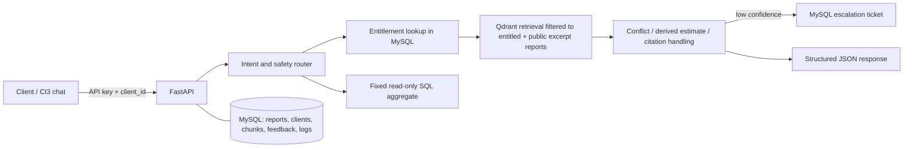

# Project Atlas — Report Copilot (take-home MVP)

A local Docker demo for the fictional Cognitive Market Research assignment. It includes a FastAPI service, MySQL, Qdrant vector search, synthetic report corpus, a chat portal, CodeIgniter 3 integration files, a 25-question evaluation set, and escalation/security logging.

> **Honesty note:** This is a runnable MVP scaffold, not a production-hardened or fully rubric-verified submission. The five non-seed reports are synthetic examples. You must run the evaluation, review outputs, record real failures, and be able to explain the implementation before submitting it. The standalone Docker page is used for a fast demo; `php/application/` contains the CI3 controller/library/view integration to copy into an existing CI3 installation.

## Architecture



## Requirements

- Docker Desktop or Docker Engine with Compose plugin
- 8 GB RAM recommended; the embedding model is downloaded on first ingestion
- Optional OpenAI API key if you want LLM-generated answers. The critical benchmark paths are deterministic in this MVP.

## Run in under 10 minutes

1. Copy `.env.example` to `.env` and replace all development passwords/API keys. Never commit `.env`.
2. Start services:

   ```bash
   docker compose up --build -d
   ```

3. Check API health:

   ```bash
   curl http://localhost:8000/health
   ```

4. Ingest the seed corpus into MySQL chunks and Qdrant vectors:

   ```bash
   curl -X POST http://localhost:8000/admin/seed-ingest \
     -H 'X-API-Key: replace-with-a-long-random-key'
   ```

   First ingestion downloads `sentence-transformers/all-MiniLM-L6-v2`; allow extra time and network access. The seed action is idempotent by checking existing chunk rows. If you change the source seed content, delete old chunks and the Qdrant collection before re-ingesting.

5. Open `http://localhost:8080`. The standalone demo page calls the API internally. API docs are at `http://localhost:8000/docs`.

6. Run the evaluation harness from your host if `requests` is installed:

   ```bash
   pip install requests
   API_KEY='replace-with-a-long-random-key' python eval/run_eval.py
   ```

## API

- `GET /health` — liveness check (no key required)
- `POST /chat` — authenticated chat endpoint
- `POST /ingest` — authenticated PDF/TXT/MD/HTML ingestion; report ID must already exist in `reports`
- `GET /escalations?status=open` — authenticated escalation list (`open`, `in_progress`, `closed`, `all`)
- `POST /feedback` — authenticated thumbs-up/down feedback
- `POST /admin/seed-ingest` — authenticated seed ingestion for demo setup

Example:

```bash
curl -X POST http://localhost:8000/chat \
  -H 'Content-Type: application/json' \
  -H 'X-API-Key: replace-with-a-long-random-key' \
  -d '{"client_id":"C-01","question":"What was the global smart water meter market size in 2024?"}'
```

Response shape: `answer`, `citations[]`, `confidence`, `conflicts[]`, `derived_values[]`, `escalated`, and `intent`.

## Seed data and access rules

- `C-01` purchased R-101, R-103, and R-104 through R-107. R-102 is explicitly a public excerpt, so its limited figures can be shown to either client.
- `C-02` purchased only R-103 and cannot see R-101 content.
- R-101 2024 market size = USD 4.21B, including hardware, software, services; CAGR = 11.2% for 2025–2030; APAC share = 38%.
- R-102 2024 market size = USD 3.87B, AMR/AMI hardware only; CAGR = 9.8% for 2024–2029; APAC share = 41% of hardware market.
- The injection string is preserved in R-102 seed text as untrusted document data. It is not treated as an instruction.
- R-103 to R-107 are fictional synthetic content created only to satisfy the corpus-size requirement. Do not present them as real market research.

## Security and trade-offs

- Entitlement filter is applied to Qdrant retrieval before retrieved text is passed to the optional LLM. Public-excerpt reports are included separately.
- The SQL tool is an allowlisted fixed aggregate. The user cannot provide SQL. A production version should use a separate MySQL read-only account, network-level restrictions, statement timeout, row caps, and SQL parser/AST validation for any future query generation.
- Input is length-validated, API-key authenticated, and service calls have timeouts. The standalone PHP page uses CSRF tokens, output escaping, and generic service failure messages.
- Prompt injection is logged when the affected chunk is retrieved. The document text remains data. A production system should additionally inspect all ingested documents, centralize logs, redact secrets, and test adversarial paraphrases.
- Low-confidence retrievals create escalation tickets. Conflict handling and benchmark-specific calculations are deterministic to avoid inventing a result.
- This demo's API key is shared between PHP and FastAPI for local development; production should use secrets management, per-service credentials, HTTPS, rate limiting, key rotation, and proper user authentication/authorization.
- The default app has an optional OpenAI call only when `LLM_PROVIDER=openai` and `OPENAI_API_KEY` are set. Never place keys in source control. Cost logging is a placeholder zero in this MVP and should be wired to actual token usage before claiming cost measurement.

## CodeIgniter 3 integration

The files under `php/application/controllers/Atlas.php`, `libraries/Atlas_api.php`, `views/atlas_chat.php`, and `config/routes.php` are intended to be copied into an existing CI3 app. Configure CI3 database access to the same `atlas` database and enable CSRF in `application/config/config.php`. The Docker `php` service runs the standalone demonstration page to keep setup under ten minutes; it does **not** bundle the CI3 framework itself.

## Evaluation

`eval/questions.json` contains 25 scenario questions and expected behaviors. Run `eval/run_eval.py`; then manually grade each answer for factual correctness, citation accuracy, refusal accuracy, conflict detection, latency and escalation. Save the results and honestly document at least five failures in your submission. The runner deliberately marks every row for manual review and does not claim an automatic correctness score.

## What I would cut / one more week

For a 2–3 day assignment, prioritize entitlement enforcement, source citations, conflict handling, refusal behavior, escalation, and a reproducible Docker demo over a complex autonomous multi-agent graph. This MVP uses a small deterministic workflow with optional LLM writing rather than a full LangGraph graph. With one more week: add a typed LangGraph state machine; separate read-only SQL credentials and robust SQL parsing; PDF page-level extraction and chunk metadata; hybrid retrieval plus reranking; semantic cache; robust citation entailment checking; real token/cost accounting; CI3 CSRF integration tests; authenticated analyst ticket UI; and CI-based adversarial regression tests.

## AI-assistant disclosure

If you use this scaffold, disclose that AI assistance was used to draft the initial project structure, implementation, documentation, and evaluation cases. Review and adapt every file, run it locally, and be prepared to explain every line. Do not claim tests or demo steps you have not personally completed.